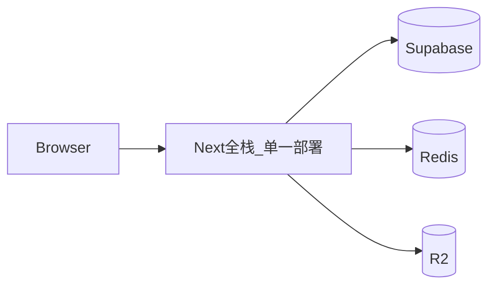

# Cloudflare Full-Stack Refactor Guidance（北极星）

**Status:** Accepted direction (guidance only; not an execution checklist)  
**Audience:** Humans and agents working on the deploy/API topology refactor  
**Language:** Chinese (working decisions for this refactor)

> **本文用途：** 整次改造的方向与约束。任何执行者（人或 AI）在幻觉、过度设计、或与旧 AGENTS/三服务惯性冲突时，**先回到本文**，再改代码。  
> **本文不是：** 任务拆分、排期、逐步 PR 清单、具体文件搬家说明书。

---

## 0. 防跑偏：先读这三块

### 0.1 一句话北极星

> **一个可部署的 Next 应用 = UI + 全部 API**；数据面用免费 SaaS（Supabase / Redis / R2）；**默认无独立 api/worker 容器**；第三方资源**按需**；能在 Cloudflare Workers 上跑是目标平台。前期尽量少付计算费，不把「VPS 三件套」当开源默认交付。

### 0.2 已锁定（改这些必须先改本文并经人确认）

| ID  | 锁定项                                                                                                                 |
| --- | ---------------------------------------------------------------------------------------------------------------------- |
| L1  | **Web = API**；目标态 **不用 Hono**（不「嵌 Hono 进 Next」当终态）                                                     |
| L2  | 默认交付 **单一应用**；Jobs **非默认**；若要则可自建机 + **共享 DB/Redis**                                             |
| L3  | 第三方 **不做全量同步主路径**，改为 **按需**                                                                           |
| L4  | 公共对象 **R2 自定义域公网读**；个人上传 **要做**，用 **私有 + 预签名**（或等价），不是关闭上传                        |
| L5  | TTS：**Azure Speech REST**（`fetch`/SSML）；**去掉原生 Speech SDK**；**不默认 Workers AI**                             |
| L6  | AI：**Vercel AI SDK（`ai` + `@ai-sdk/openai`）**；**不强求 / 不默认保留 LangChain**                                    |
| L7  | 体感延迟开源阶段可接受约 **1s 内**；但 **Free CPU 配额 ≠ 体感**（超配额是失败不是变慢）                                |
| L8  | 部署合并 ≠ 逻辑糊进 UI；**server 领域与 `shared/` / `server/db` 边界可保留**（原 `@gloaming/shared` / `@gloaming/db`） |

### 0.3 明确禁止（常见跑偏）

| 禁止                                                   | 为何                                          |
| ------------------------------------------------------ | --------------------------------------------- |
| 把「嵌 Hono」写成最终架构                              | 与 L1 冲突；Hono 只可能是迁移期过渡，不是目标 |
| 默认恢复 `web+api+worker` / BullMQ 常驻为开源推荐拓扑  | 与北极星冲突                                  |
| 复活 Gutenberg **全量**同步当主路径                    | 与 L3 冲突；已在线上失败过                    |
| 为「更边缘」默认上 **Workers AI** 做 TTS/LLM           | 与 L5/L6 及「前期少新开 CF AI 付费面」冲突    |
| 用「用户不在乎慢」推出「Free 10ms CPU 一定够」         | 概念偷换；须实测                              |
| 宣称「个人上传不做」                                   | 误解 L4                                       |
| 无授权改核心业务语义 / 复活遗留 Article 等模型         | 超出本文；见仓库 AGENTS 产品边界              |
| 把本文当「已经批准开始大规模删 worker/迁路由」的执行令 | 本文只定方向；动手前另有任务拆分与门禁        |

### 0.4 仍未决（允许调查，禁止假装已定）

- Workers **Free** 对本应用关键路径是否稳定（登录等是否 1102）
- EPUB **重解析**落在请求内轻量做、还是日后 Jobs/Queue（未拍板）
- 是否启用 Jobs / CF Queues（**以后再说**）
- OpenNext vs vinext：以冒烟为准，不口号锁死

### 0.4a 已决（原 §0.4 第三方按需能力）

- V1 源 **Project Gutenberg 官方 OPDS** 具备按需检索/浏览；Discover 主路径为远程 OPDS（热门 + 搜索 + 源原生 Category bookshelf），**禁止** RDF 全量/半量同步当主路径。
- Gloaming **公共分类模块已移除**；不做跨源统一本地分类层。

### 0.5 执行者如何用本文纠偏

1. 先核对 **0.1–0.3**：提案是否违反锁定/禁止。
2. 若与仓库 [`AGENTS.md`](../AGENTS.md)「web/backend 分离、三服务」等**旧交付叙事**冲突：**以本文改造方向为准**（交付拓扑与 API 归属），产品禁区（不复活 Article 等）仍遵 AGENTS。
3. 未决项 → 标为 spike/门禁或问人，**不要发明「已经决定用 X」**。
4. 需要改 L1–L8 → **先改本文并经人确认**，再写代码。

---

## 1. 目的（核心动机）

1. **Web 即接口**：全部 HTTP API 落在 Next 应用内；**部署前端 = 部署接口**。部署拓扑保持干净（默认一个应用服务）。
2. **不再使用 Hono 作为长期 API 框架**：目标形态是 Next Route Handlers / 服务端模块。日后若要做 App/独立后端，再考虑拆 API 或 Nest——不预支进当前默认架构。
3. **Jobs 非默认、可后置**：需要时可在自有机器跑，与 Web **共用同一 Postgres/Redis**。
4. **数据面免费 SaaS + 计算尽量免费起步**：Supabase、R2、现有免费 Redis；计算优先 Workers。前期尽量不付费；有量后再考虑 Workers Paid。
5. **第三方按需获取**，不做全量同步主路径。
6. **媒体**：公共资源公网域名直出；**个人上传照做**，读写模型见第 6 节（不是关闭个人上传）。
7. 规则、目录、代码、技术方案均可调整。

### 1.1 已对齐的产品取舍

| 议题          | 结论                                                                   |
| ------------- | ---------------------------------------------------------------------- |
| Hono          | **弃用**（目标态）；Web = API                                          |
| 用户体感延迟  | 开源阶段 **1s 内可接受**                                               |
| 公共图片/对象 | **公网 R2 域名直出**                                                   |
| 个人上传      | **要做**；桶不必整桶公开（公私模型分离）                               |
| Jobs          | **以后再说**；需要则自建机 + 共享 DB/Redis                             |
| 付费          | **前期尽量 $0**；有量再 Paid                                           |
| TTS           | **优先 Azure Speech REST**（`fetch`/SSML）；不默认上 Workers AI        |
| AI 辅助       | **Vercel AI SDK（`ai` + `@ai-sdk/openai`）**；不强求 LangChain；见 6.3 |

---

## 2. 当前遇到的问题（为何要改）

| 问题                | 表现                     | 根因方向                 |
| ------------------- | ------------------------ | ------------------------ |
| 部署过重            | `web` + `api` + `worker` | 前后端分离 + BullMQ 常驻 |
| 开源/独立开发不友好 | 难靠免费档干净交付       | 默认假设 VPS 与内网 API  |
| 第三方同步失败      | 部分同步后中断、重试被掐 | **全量同步**脆弱         |
| 运维心智重          | 三服务生命周期           | 请求面与后台面绑死       |

---

## 3. 改进方向（方针）

### 3.1 交付

- 单一应用：Next = UI + API；Workers 优先；目标态不用 Hono。
- Jobs 不进默认开源拓扑。

### 3.2 长任务与第三方

- 按需拉取；Jobs 延期决策。

### 3.3 对象存储

- 公共：自定义域公开读 + DB 存路径 + 前端拼接。
- 个人：功能保留；**私有桶 + 预签名**等（第 6 节）——不是不做上传。

### 3.4 模块

- 部署合并 ≠ 代码糊成一团；shared/db 契约可保留。

---

## 4. 大模块（指导级，非任务卡）



部署叙事、API 归属、Discovery 按需、媒体公私模型、仓库规则与「单部署单元」对齐。细节不在此写死。

---

## 5. 平台可行性摘要

- Next Route Handlers + OpenNext/vinext：**成熟**。
- Supabase + Hyperdrive：**官方路径**。
- Redis：Workers 上优先 HTTP（如 Upstash REST）。
- **墙钟延迟 ≠ Free CPU 配额**：体感可接受慢；超 CPU 是直接 1102。前期 $0 要靠实测，不是靠「我不在乎慢」。

---

## 6. 问题讨论：社区有没有解法？

有。类似需求（Next 全栈、鉴权、文件、AI 流式）在 CF Workers 上已有生产案例。只谈问题与解法。

### 6.1 个人上传：不是「先不开放」

先前意思是：**别把私有文件和公共封面都做成「整桶永久公开」**——不是关闭个人上传。

| 资源类型          | 社区常见做法                                                                    |
| ----------------- | ------------------------------------------------------------------------------- |
| 公共封面/公开书库 | 自定义域公网读；DB 存 key；前端拼接                                             |
| 个人 EPUB/上传    | **私有桶**；登录后发**短时预签名 PUT/GET**；浏览器直传直下，Worker 不扛文件字节 |
| 变体              | 难猜 key + 不 list；或同源下载网关验权后 302 到预签名 URL                       |

依据：[R2 Presigned URLs](https://developers.cloudflare.com/r2/api/s3/presigned-urls/)。社区强调：公共资源别无谓签名；私有资源别永久公开 URL。

**结论：个人上传可做，且与公网直出不冲突——两类资源两种读法。**

### 6.2 TTS：默认继续 Azure REST（不为「免费」去上 Workers AI）

仓库现用原生 `microsoft-cognitiveservices-speech-sdk`——这是 Workers 上的坑（XMLHttpRequest 等），不是 Azure 服务本身的坑。

**已拍板默认路径：Azure Speech REST**（`fetch` + SSML → 音频）。官方支持、成熟；可继续用现有 Azure 资源/音色/密钥；与 Workers 模型契合。  
**Workers AI TTS**：一般有用量/计费（含免费额度也有限），**不作前期默认**；只有明确愿意用 CF AI 产品时再议。

要换掉的是原生 SDK，不是换掉 Azure。

### 6.3 AI 辅助：推荐 **Vercel AI SDK**（具体选型）

**推荐锁定：[`ai`](https://sdk.vercel.ai/)（Vercel AI SDK）+ [`@ai-sdk/openai`](https://sdk.vercel.ai/providers/ai-sdk-providers/openai)**（OpenAI 兼容提供方）。

| 维度            | 为何选它                                                                                                                                           |
| --------------- | -------------------------------------------------------------------------------------------------------------------------------------------------- |
| CF 友好         | Cloudflare 官方文档直接教 AI SDK；OpenNext/Workers 生产案例大量使用                                                                                |
| 轻              | 比 `langchain` + `@langchain/*` 树小；核心是 `generateText` / `streamText` / `tool`                                                                |
| 流式            | `streamText` → `toTextStreamResponse` / UI message stream，贴合现有 assist SSE                                                                     |
| Tool / 多轮     | `tool({ inputSchema: zod, execute })` + `stopWhen: stepCountIs(n)`，对应你们现在的 `bindTools` + maxToolRounds                                     |
| 与现网一致      | 你们已是 **OpenAI-compatible**（`ChatOpenAI` + `baseURL`/`apiKey`/proxy）；AI SDK 用 `createOpenAI({ baseURL, apiKey, fetch })` 即可接同一批模型行 |
| 结构化输出      | `Output.object` / JSON 模式，可覆盖现有 `jsonObject` 类需求                                                                                        |
| 不绑 Workers AI | 继续打你们自己的 LLM 网关/密钥，不强制 CF 计费 AI                                                                                                  |

**对照本仓库现有能力（LangChain 路径）→ AI SDK：**

| 现有（LangChain）                                       | AI SDK 对应                                                        |
| ------------------------------------------------------- | ------------------------------------------------------------------ |
| `ChatOpenAI` + `configuration.baseURL`                  | `createOpenAI({ baseURL, apiKey })`                                |
| `tool` + Zod schema（dictionary / part slice / search） | `tool` + `inputSchema`（Zod）                                      |
| 多轮 `bindTools` + `maxToolRounds`                      | `streamText`/`generateText` + `tools` + `stopWhen: stepCountIs(n)` |
| 流式 chunk / SSE                                        | `streamText` 流                                                    |
| `PromptTemplate`                                        | 普通字符串/消息数组即可（可保留自研 prompt 拼装）                  |

**不推荐作为默认：** LangChain 全量、Mastra、自研裸 `fetch` 拼 tool protocol（重复造轮、难维护流式+多轮）。  
**可选补充（非必须）：** 若日后要用 Workers AI 模型，再用 CF 的 `createAI` provider 挂到同一套 AI SDK 调用面上——与「前期不用 Workers AI」不冲突。

**结论：替换目标就是 Vercel AI SDK；保留你们的「解析模型行 → OpenAI 兼容 HTTP」运行时外壳，只换掉 LangChain 调用层。**

### 6.4 同类需求，CF 上常见技术栈

```text
Next.js App Router + OpenNext/vinext → 单一 Worker
Better Auth
D1+Drizzle 或 Postgres+Hyperdrive（Supabase）
R2（公网域 / 预签名）
KV 或 Upstash Redis
AI SDK 流式 ± Workers AI / 外部 LLM HTTP
可选：Cloudflare Queues、Durable Objects
```

| 你的目标             | 社区是否常见                           |
| -------------------- | -------------------------------------- |
| 单 Worker = 前端+API | 是                                     |
| Supabase Postgres    | 是（Hyperdrive）                       |
| R2 + 公私读写分离    | 是                                     |
| 少 VPS Jobs          | 是；部分人用 **CF Queues**（仍无 VPS） |
| AI SDK 流式          | 很常见（本方针默认）                   |
| Azure Speech REST    | 适合继续用现有 Azure；原生 SDK 少见    |

走 CF 的人通常 **换掉重 Node 原生假设**，用 HTTP/binding，而不是原封搬 VPS 依赖。

### 6.5 其它心里有数的点

| 问题        | 社区态度                                                  |
| ----------- | --------------------------------------------------------- |
| Free CPU    | 与体感无关；不稳再 Paid                                   |
| EPUB 重解析 | 边缘少整本 native 解析；存 R2 + 轻量抽章，或 Queue/自建机 |
| Redis       | Upstash REST 常见                                         |
| Better Auth | 有人生产在用；须 Workers 实测                             |

---

## 7. 讨论阶段原则

- Web = API；目标态不用 Hono。
- 先问社区怎么解，再问我们是否照做。
- **个人上传要做**；公私模型分开。
- TTS：**Azure REST**；不为省事默认上 Workers AI。
- AI：**AI SDK**；不强求 LangChain。
- **本文不做任务/阶段拆分。**

> 说明：Azure Speech 本身通常也按用量计费（你已有的云资源）；这里「尽量免费」指的是**尽量不新开 CF Workers AI 等付费面**，并保留已有 Azure 路径，而不是声称 TTS/LLM 云服务永久 $0。

## 8. 参考链接

- [Next on Workers](https://developers.cloudflare.com/workers/framework-guides/web-apps/nextjs/) / [OpenNext](https://opennext.js.org/cloudflare)
- [R2 Presigned URLs](https://developers.cloudflare.com/r2/api/s3/presigned-urls/)
- [LangChain on CF Workers](https://docs.langchain.com/langsmith/deploy-cloudflare-workers)
- [Workers AI + AI SDK](https://developers.cloudflare.com/workers-ai/configuration/ai-sdk/)
- 案例气质：inspir、Clickfolio、Teknora（Next + OpenNext + R2 + AI）

## Related

- Stage order (historical **`migration/`** staging → promote to repo-root single package; Workers last; contracts inlined under `shared` + `i18n`) and P1 charter:
  [`cloudflare-fullstack-refactor-stages.md`](./cloudflare-fullstack-refactor-stages.md)
- Current deploy topology (to be superseded for the target state): [`deployment.md`](./deployment.md)
- Agent / product boundaries + transition priority:
  [`../AGENTS.md`](../AGENTS.md) (Deploy and API topology)
- Transition notes in rules: [`../rules/backend.md`](../rules/backend.md),
  [`../rules/frontend.md`](../rules/frontend.md),
  [`../rules/architecture.md`](../rules/architecture.md),
  [`../rules/packages.md`](../rules/packages.md)
