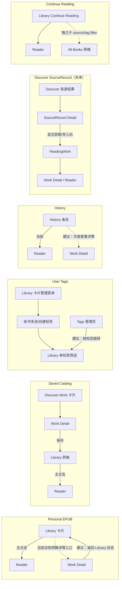

# Gloaming：Library / Tags / Book Detail 产品信息架构审查

> 阶段：调查与方案建议。本文只记录当前证据和待决产品方案；不表示任何方案已获批准，也不包含实现。
>
> 证据标签：**FACT** = 当前源码或本次运行环境直接确认；**INFERENCE** = 基于证据的解释；**PROPOSAL** = 建议方向；**DECISION_REQUIRED** = 需要产品负责人决定。

## 结论摘要

- **FACT**：Library 当前由「Continue Reading + All Books 网格」组成；网格可按来源和一个用户标签筛选。Personal 上传作品与明确保存的 Catalog Work 都进入同一网格，但通过不同的 membership 语义区分。
- **FACT**：User Tags 是每用户私有的组织标签，支持创建、重命名、删除和给 Library Work 关联；不是全站分类，也不是 Gutenberg subject 的替代物。当前没有确认到 AI 标签的活动数据模型、API 或页面消费链。
- **FACT**：Book Detail 组件路由位于 `/discover/[workId]`，数据由 `/api/catalog/works/:id` 提供；当前后端访问策略也允许登录用户读取自己的 Personal Work。页面的手机端返回链接固定回 Discover。Library 和 History 列表则直接打开 Reader。
- **FACT**：本次登录浏览器中，Miss Moppet 在 Library 显示「阅读中」，直接打开详情页后按钮显示「开始阅读」；对应代码在进度为 0% 时把 `in_progress` 映射成 `unread`。这是来源明确的状态语义不一致。
- **PROPOSAL**：保留一个以 Library 为中心的阅读与整理空间：来源筛选和私有标签筛选共同作用于同一书格；Continue Reading 独立于过滤器；卡片菜单承担快速管理；标签管理页专注批量重命名/删除。
- **PROPOSAL**：将“阅读作品详情”和“尚未保存的发现内容详情”在路由身份上区分，即使未来复用部分展示组件，也不要用相同 URL/ID 来混淆 `ReadingWork` 与 `SourceRecord`。
- **DECISION_REQUIRED**：确定 Library 卡片主点击应直接阅读还是先到详情；详情页从 Library/History 进入后的返回目标；保存 Catalog 的中文文案应表达“已收藏”还是“已保存”；是否需要未来 AI 标签建议。

## 1. 审查范围与证据

### 范围

本轮审查 Library、User Tags 与 Book Detail 的页面分工、导航关系、交互、数据模型、路由/API 契约和开发环境可观察到的页面状态。没有修改业务代码，没有显式调用创建/编辑/删除用户数据的接口，没有运行迁移或同步。

### 证据边界

- **FACT / 源码**：以下引用是本次读取的当前 `dev-02` 工作区代码；文件路径与行号供后续实现前复核。
- **FACT / 浏览器**：本次在 Codex 内置浏览器的登录开发会话查看 `/library`、`/library/tags`、`/discover` 和 Miss Moppet 详情页，并刷新详情页。Discover 当前显示空状态；因此没有把空的 Discover 结果当作功能在所有环境均不可用。
- **LIMITATION**：此轮没有显式调用业务写接口，也未使用自动化浏览器。详情 GET 调用的 `getCatalogWork()` 会在 Work 缺少 `wordCount` 时调用 `ensureWorkReadingStatsIfMissing()`，其实现会回填派生统计字段；本轮没有检查数据库确认 Miss Moppet 是否触发了这一条件。因此不能断言浏览器打开详情绝对没有数据库写副作用。运行观察仅说明当前本地登录会话的实际表现。
- **历史文档提示**：User-first 文档目录中的早期评估包含旧 Catalog taxonomy 方案。与当前 Schema、路由和交互冲突时，以当前源码为运行事实；历史材料仅用于追溯背景，不作为现行需求。

## 2. 当前信息架构与能力

### 2.1 页面与入口

| 页面                 | 当前职责                                                    | 主要入口/去向                         | 证据                                                                    |
| -------------------- | ----------------------------------------------------------- | ------------------------------------- | ----------------------------------------------------------------------- |
| `/library`           | Continue Reading、书库网格、来源与标签筛选、书籍卡片管理    | Reader、卡片管理菜单、`/library/tags` | `apps/web/features/library/library-page.tsx:59-159`；`library-grid.tsx` |
| `/library/tags`      | 创建、重命名、删除私有标签；显示每个标签关联书数            | 返回 Library                          | `apps/web/features/library/library-tags-page.tsx:89-225`                |
| `/discover`          | Catalog Work 发现列表                                       | Discover 卡片进入 Book Detail         | `apps/web/features/discover/discover-api.ts`；`discover-book-card.tsx`  |
| `/discover/[workId]` | Catalog/Work 详情、阅读 CTA、保存到 Library、章节目录与推荐 | Reader、推荐详情；手机返回 Discover   | `apps/web/features/book-detail/book-detail-page.tsx:75-130`             |
| `/reading-history`   | 按阅读记录呈现已读/在读作品                                 | 条目直接进入 Reader                   | `apps/web/features/history/history-works.tsx:29-70`                     |
| `/read/[workId]`     | 阅读体验                                                    | Reader TOC 可进入作品详情             | `apps/web/features/reader/reader-toc-sidebar.tsx`                       |

**FACT**：Library 与 History 的主列表都直接跳到 `/read/:workId`，不经过 Book Detail。Book Detail 的常规列表入口是 Discover 卡片与推荐区；Reader 的 TOC 也有详情入口。源码路由 helper `AUTH_ROUTES.bookDetail(id)` 当前生成 `/discover/${id}`。

**FACT**：Book Detail 的移动端返回按钮硬编码为 Discover；桌面端当前组件没有对应返回按钮。直接从 Library/History 打开详情时，返回路径不表达来源页面。

### 2.2 Library 网格和筛选

**FACT**：`GET /api/library` 返回 `current` 与 `items`。Backend 将当前在读项单独查询；网格 items 由当前用户拥有的 Personal Works 与用户明确保存的 Catalog/Source Work 合并排序，再统一限制为最多 48 条。前端来源过滤和标签过滤在此列表上做交集。证据：`apps/backend/src/domains/library/service.ts:37-95`、`packages/shared/src/library/library.ts:1-5`、`apps/web/features/library/library-page.tsx:117-125`。

**FACT**：Continue Reading 与网格是两个不同角色。`current` 不受来源/标签过滤；同一本书可能同时出现在 Continue Reading 和 All Books 网格中。这避免过滤一个标签时隐藏当前阅读入口，但可能产生重复卡片的视觉感受。

**FACT**：来源筛选值是 `all | personal | saved_catalog`；标签筛选状态是零个或单个 tag ID。两者同时激活时按 AND 筛选。筛选状态保存在页面组件本地 state，没有反映到 URL query。

**INFERENCE**：48 条截断发生在服务端筛选之前，当前没有 Library 分页契约。因此大量书籍时，较旧的条目可能无法通过来源/标签过滤重新取回；用户可能误以为筛选结果就是完整匹配集。

### 2.3 User Tags 的真实语义

**FACT**：活动模型为 `user_tag` 与 `user_work_tag`。标签归属于一个用户，规范化名称按用户唯一；书与标签的关联同样绑定该用户。字段及约束见 `packages/db/src/schema.ts:200-240`。Shared DTO 将其称为 private organization labels：`packages/shared/src/library/library.ts:7-21`。

**FACT**：标签管理页提供创建、重命名、删除、关联书数和删除确认；书格卡片菜单的 Dialog 支持给当前作品多选标签，并可以快速创建并关联。标签 CRUD API 为 `/api/library/tags`；关联 API 为 `/api/library/:workId/tags/:tagId`。具体路由见 `apps/backend/src/domains/library/tags/routes.ts:23-52`，UI 见 `library-tags-page.tsx` 与 `library-tag-assignment-dialog.tsx`。

**FACT**：标签列表页本身不提供「点标签打开匹配书格」入口；标签筛选入口位于 Library 网格。当前网格筛选一次只选一个标签，但单本书可以关联多个标签。

**FACT**：当前活动 Work Schema 不存在全站 Category/Tag taxonomy；Gutenberg SourceRecord 的 subjects/bookshelves 是来源元数据，与用户私有标签是不同数据。EPUB 的 AI 标签推荐链未在当前活动代码中确认到。

**PROPOSAL**：继续把 User Tags 定义为用户整理工具；Gutenberg subjects/bookshelves 保留为来源事实；未来 AI 建议若获批准，应先定义为建议/待确认状态，不应自动写入用户私有标签或伪装成来源元数据。

### 2.4 Book Detail 的数据和身份

**FACT**：前端详情查询先取 `/api/catalog/works/:id`，并并行读取 Library、章节、ReadingState；匿名访问时 Library/ReadingState 的 401 可降级为空。预计阅读时长优先使用 Work 字段，缺失时由章节字数估算；difficulty 和 suggested vocabulary 直接使用 Work 统计字段。证据：`apps/web/features/book-detail/book-detail-api.ts:27-68,157-172`。

**FACT**：后端详情读取使用集中式 `workReadAccessSql`：公开已发布 Catalog Work、当前用户自己的 Personal Work，或满足条件且由该用户保存的 Source-materialized Work。参见 `apps/backend/src/domains/works/catalog/catalog.ts:75-84` 与 `apps/backend/src/domains/works/access/predicate.ts:14-73`。因此页面注释“published work UUIDs”比真实访问能力窄，路由名称 `/discover/[workId]` 也不能准确表达所有可读 Work。

**FACT**：一个 `ReadingWork` 有自己的 Work ID；Gutenberg `SourceRecord` 是独立来源记录 ID。两者的详情不能只靠未区分的 UUID 动态路由判定实体类型。Catalog/Work 详情 API 与 Discover 列表读取 Work；SourceRecord 查询/详情属于另一契约。

**FACT**：Library/History 卡片没有到详情的二级入口；卡片主点击直接阅读。详情页没有编辑个人 EPUB 元数据、关联 User Tags 的操作入口；这些管理能力在 Library 卡片菜单。

**运行观察**：本次开发浏览器能够直接打开并刷新 Miss Moppet 的 Work 详情。Library 对同一本书显示“阅读中”，详情显示“开始阅读”；详情还单独显示“已在书库”。

**源码根因**：`readingStatusFromProgress()` 仅当 `status === 'in_progress'` 且 `progressRatio > 0` 才返回 `in_progress`；0% 会被降为 `unread`。见 `apps/web/features/book-detail/book-detail-model.ts:138-149`。这不改变数据库状态，而是详情层的错误投影。

**PROPOSAL**：通用的 Work Detail 可以有一个阅读作品的规范路由（例如 `/works/:workId` 或 `/books/:workId`），但只有在确认访问主体和返回上下文后才统一入口。SourceRecord 使用清晰独立的 `/discover/records/:sourceRecordId` 或等价路由；SourceRecord 详情负责“了解来源/保存或导入”，Materialized `ReadingWork` 详情负责“阅读/查看章节/阅读状态”。可复用卡片、封面、章节视图组件，但不合并实体或 ID 命名空间。

## 3. 本次发现的问题

严重度代表产品影响，不是代码缺陷评级：P1 阻断核心任务；P2 明显摩擦/误导；P3 一致性或扩展性问题。

| ID    | 页面/流程                  | 现状与预期                                                                                                                                                 | 类型 / 严重度                   | 证据                                                        | 建议                                                                                                                            |
| ----- | -------------------------- | ---------------------------------------------------------------------------------------------------------------------------------------------------------- | ------------------------------- | ----------------------------------------------------------- | ------------------------------------------------------------------------------------------------------------------------------- |
| IA-01 | Book Detail 阅读 CTA       | `in_progress + 0%` 的阅读状态被降为 unread；Miss Moppet 在 Library 是“阅读中”，详情却显示“开始阅读”。应以 ReadingState 为状态来源，0% 仅表示完成比例为零。 | 行为语义 / P2                   | 当前浏览器观察；`book-detail-model.ts:138-149`              | 修正详情投影，继续保持既有百分比算法不变；状态与 Library/History 同源。                                                         |
| IA-02 | Library 大书库检索         | API 先截断到 48 条，再由 UI 筛选；没有分页，过滤无法访问截断以外的匹配书。                                                                                 | 数据可发现性 / P2（大库触发）   | Backend service `:53-95`；Shared cap                        | 后续为筛选/分页定义服务端查询顺序与页码契约；不能只提高前端筛选。                                                               |
| IA-03 | 跨页分享/恢复筛选          | Source、Tag 筛选保存在组件 state，不在 URL；无法复制过滤结果链接，刷新/路由重挂载可能重置条件。                                                            | 导航状态 / P2                   | `library-page.tsx:64-65,117-125`                            | 采用 query 参数表达 source/tag，提供可分享、可返回的书格状态；默认状态保持 URL 简洁。                                           |
| IA-04 | 详情返回导航               | 详情在 `/discover/:id`；移动端总回 Discover，桌面无返回；从 Reader/Library 进入时语义不对。                                                                | IA / P2                         | `book-detail-page.tsx:82-90`                                | 详情入口携带明确 return context，或由规范 Work Detail 提供“返回书库/阅读历史/发现”。刷新直达时使用安全 fallback。               |
| IA-05 | Library / History 到详情   | 当前卡片主点击直接阅读，没有清晰的“查看书籍信息”次级入口；用户无法从常见列表查看章节/介绍而不启动 Reader。                                                 | 导航能力 / P2（待用户任务验证） | `history-works.tsx:42-44`；Library Card Reader 链接         | 保留主阅读操作，增加清楚但次要的详情入口；移动端避免让封面/标题主点击含义冲突。                                                 |
| IA-06 | 标签管理路径               | 管理页可改名/删除，但只能返回 Library；标签行不能直接查看该标签的书。                                                                                      | 组织流 / P2                     | `library-tags-page.tsx:89-103,138-215`                      | 让标签名/书数成为到 Library `?tag=...` 的导航入口；编辑和删除仍为独立操作。                                                     |
| IA-07 | 空 Discover 与详情实体命名 | 本次 Discover 列表为空；详情路由/API 名称表达 Catalog Work，但后端读取也可返回当前用户 Personal Work。                                                     | 产品身份 / P2                   | 浏览器观察；Catalog API/access 源码                         | 区分“来源记录发现”和“可阅读 Work 详情”，使路由/API 名称与访问语义一致。                                                         |
| IA-08 | Source 标签名              | UI 使用“已收藏”或“Saved”容易暗示收藏夹/喜欢；模型实际表达显式保存的 Library membership。                                                                   | 文案 / P3 / 决策项              | `libraryItemKind: saved_catalog`；Library source filter     | 选定“已保存/已收藏”之一并统一中英术语、详情按钮和筛选器。                                                                       |
| IA-09 | Continue Reading 重复呈现  | 当前项可同时在 Continue Reading 和 All Books 网格出现；语义上分别是快捷入口与完整集合。                                                                    | 视觉密度 / P3                   | `getLibrary()` 分开返回 current/items；LibraryPage 独立渲染 | 建议保留两种入口；通过标题说明区别。若用户测试反馈重复感明显，再考虑在 All Books 默认视图临时排除 current，但不要改变筛选语义。 |

## 4. 推荐方案与备选

### 4.1 Library：混合筛选 + 一个书格（推荐）

**PROPOSAL**：同一 Library 网格承载所有用户可访问且已加入个人书库的 Works。来源（我的上传/已保存）表达 Work 的关系；User Tags 表达用户的主题整理。两者可同时筛选，组合取交集。Continue Reading 是独立的最近阅读快捷入口，不受来源/标签条件隐藏。

推荐导航草图：

```text
Library
├─ Continue Reading                  (最近继续阅读；独立入口)
└─ All Books
   ├─ Source: All | My uploads | Saved
   ├─ Tag: All | [one selected tag]
   └─ Shared Book Grid
      └─ Card: Read / Details (secondary) / Manage menu
```

备选方案：

| 方案                                       | 优点                                                          | 代价                                                     | 判断                                       |
| ------------------------------------------ | ------------------------------------------------------------- | -------------------------------------------------------- | ------------------------------------------ |
| A. 继续当前混合书格（推荐）                | 一处浏览全部；来源和标签可交叉；不额外制造“上传书架/收藏书架” | 需要修复分页上限，并让筛选 URL 可恢复                    | 与现有 API/数据模型最贴合                  |
| B. 将 My Uploads 与 Saved 分成两个顶层页面 | 集合边界明显；各页可有专属空状态                              | 浏览路径割裂；跨来源和标签比较困难；同一管理能力容易复制 | 只有用户明确把两类内容视为不同目的地时考虑 |
| C. Continue Reading 作为 Library 唯一入口  | 强调回到阅读                                                  | 降低未开始/已完成作品的可发现性                          | 不推荐；它不是全书库                       |

### 4.2 User Tags：私有、手工、跨来源

- **PROPOSAL**：保留一套私有 User Tag。可对当前 Library 中的 Personal 与 Saved Catalog Work 使用；不要求标签等同来源分类。
- **PROPOSAL**：Library 中管理单本书的标签；标签页管理标签名字/生命周期并跳转到筛选结果。两处互补，不复制 CRUD。
- **PROPOSAL**：第一阶段维持单标签筛选；这与现有 UI 一致且选择逻辑简单。后续是否支持多个标签交集/并集，依据真实找书任务再决定。
- **PROPOSAL**：SourceRecord 的 `subjects`/`bookshelves` 作为只读来源元数据，不自动并入 User Tags。未来 AI 建议以待确认 chips 提供；只有用户确认后才写成私人标签。
- **DECISION_REQUIRED**：本轮没有证据证明当前需要 AI 自动生成或自动应用标签。建议 MVP 不纳入；如果要做，需要明确自动/建议、审核、去重和撤回语义。

### 4.3 Book Detail：通用 Work 阅读详情 + 来源记录详情分离

建议阅读 Work 的详情承担：书名、作者、来源、介绍、可用性、进度/状态、章节目录、阅读 CTA、Library membership。Personal Work 另外显示个人编辑/删除/管理入口，避免将其误认为 Catalog 发布动作。

建议 SourceRecord 详情（若后续开发 Discover）承担：Gutenberg 来源信息、候选格式/可用性、原始来源描述与 subjects/bookshelves、获取/导入动作。SourceRecord 页可以关联到已经物化的 Work，但保留两个 ID 字段和实体边界。

返回行为建议：

- 从 Library 进入 → 返回相同 Library 筛选和滚动位置。
- 从 History 进入 → 返回 History。
- 从 Discover 进入 → 返回 Discover 的查询/分页状态。
- 直接打开或刷新 → 使用规范 fallback（Work 回 Library 或浏览器历史可用时返回）。

**DECISION_REQUIRED**：是否增加 Library/History 的详情次级入口；推荐增加，但不替代“一键开始/继续阅读”的主入口。

## 5. 六条用户流程图

以下左侧为当前已观察/源码路径，右侧是建议路径。未来路线是提案，不代表已有实现。



## 6. 低保真线框

### Library

```text
┌ Library ───────────────────────────────────────────── [Manage tags] ┐
│ Continue Reading                                                    │
│ [cover]  Title · chapter/progress                    [Continue →]   │
├ All Books ──────────────────────────────────────────────────────────┤
│ Source: [All] [My uploads] [Saved]                                  │
│ Tag:    [All] [Fantasy] [Favorites]                                 │
│                                                                    │
│ [Book card]   [Book card]   [Book card]   [Book card]              │
│  Read →       Details ↗      ⋯ Manage                               │
└────────────────────────────────────────────────────────────────────┘
```

### Tags

```text
← Library
Manage tags
[Tag name________________________________] [Create]

Fantasy               8 books     [Rename] [Delete]
History                3 books     [Rename] [Delete]
```

建议标签名或书数点击后跳回 `Library?tag=<id>`；行内操作仍只做 rename/delete。

### Reading Work Detail

```text
← Back to Library / History / Discover (preserve return context)
[Cover]  Title
         Author · Language · source
         [Continue reading →]   [In Library]
         Reading status / progress
About · estimated time · level
Chapters
Related works
```

### SourceRecord Detail（后续 Discover 阶段）

```text
← Discover
Gutenberg title · author · source record ID/status
Original description · subjects · bookshelves
Available formats [EPUB candidate]
[Open existing Work] or [Add/import to Library]
```

## 7. 状态盘点

| 能力                                 | 当前状态                                      | 说明                                                                        |
| ------------------------------------ | --------------------------------------------- | --------------------------------------------------------------------------- |
| Personal EPUB 进入 Library           | **现有**                                      | Owner Work 出现在自己的 Library；与 Saved Catalog membership 分开           |
| Continue Reading                     | **现有**                                      | 当前 in-progress 状态独立返回，不代表 Library membership                    |
| 来源过滤                             | **现有**                                      | All / Personal / Saved Catalog；UI 对已载入的列表过滤                       |
| User Tag CRUD                        | **现有**                                      | 私有标签创建、重命名、删除、书数                                            |
| 单书标签关联                         | **现有**                                      | 卡片菜单 Dialog 支持多标签及快速创建                                        |
| User Tag 网格筛选                    | **现有**                                      | 仅单标签选择；与 Source 条件 AND 组合                                       |
| Work Detail                          | **现有但路由语义不一致**                      | 一个详情 UI 通过 `/discover/:workId`，后端可按访问策略返回不同类型可读 Work |
| SourceRecord Discover/Detail         | **后端数据/契约部分存在；本次 UI 未可用验证** | 当前开发 Discover 页面为空；不能把此轮空状态推断为永久缺陷                  |
| AI 标签建议                          | **未确认/未验收**                             | 没有当前活动链路证据；需要单独产品决定                                      |
| 书库分页和筛选 URL                   | **未实现**                                    | 48 条硬上限；筛选 state 不进入 URL                                          |
| Library/History 到详情的清晰次级入口 | **未实现**                                    | 当前条目主操作直接进入 Reader                                               |

## 8. 域、路由与 API 影响

### 最小改动方案（若之后批准）

1. **低风险前端一致性**：按 `ReadingState.status` 映射 Book Detail CTA；百分比继续负责展示进度而非决定是否在读。
2. **低风险 Library 导航**：增加详情次级入口、保留 return context；筛选状态用 URL query 序列化。
3. **Library 数据完整性**：将 source/tag 过滤条件与分页交给服务端或新增 cursor-based Library 查询，避免先取 48 后过滤。需要先定义排序稳定性和 `current` 的独立语义。
4. **实体分路由**：为 Work Detail 与 SourceRecord Detail 选定规范 URL；避免对 UUID 做含糊判别或将 `SourceRecord` ID 当 `ReadingWork` ID。
5. **无必要 Schema 变更**：现有 User Tag 关系足够支撑上述 IA；不要另建 Category、AI Tag 或收藏模型来解决标签导航问题。

### 需要 API/架构决定的边界

- 48 条上限问题涉及 Library 列表 API 的分页与筛选契约；不是单纯组件调整。
- SourceRecord 详情要消费 SourceRecord DTO/API，Materialized Work 详情继续消费 Work DTO/parts/ReadingState。若需要将来源记录物化成可读 Work，必须沿既有 Save/ingest 生命周期，不用伪造 Library membership。
- 统一视觉组件可以共享，但读写权限应由 Work Access Policy 决定；不能因详情页 URL 可见而扩展内容访问权限。
- 本报告没有建议修改数据库 Schema，也没有授权后续实施。

## 9. 推荐最小分期

### Phase 0 — 产品决策冻结

- **目标**：确定 Library 卡片主/次入口、详情返回目标、Saved 文案、标签筛选语义、AI 标签是否延期。
- **范围**：只锁定行为和术语，不动代码。
- **验收**：六条主流程具备明确起点/终点/返回规则；Work 与 SourceRecord 身份分开。
- **风险**：若入口语义未冻结，后续重排会在导航与路由之间反复。

### Phase 1 — Library/Detail 语义一致

- **目标**：阅读状态、详情 CTA 与 Library/History 一致；补齐从书格进入详情的次级路径及返回上下文。
- **范围**：Web 状态映射、路由 state、必要的交互测试；不修改 ReadingState 持久化。
- **验收**：`in_progress + 0%` 仍显示继续阅读；Library/History/Detail 往返语义正确。
- **风险**：错误的 back fallback 可能将直达链接送到无关页面。

### Phase 2 — 标签整理闭环

- **目标**：管理标签时能直接打开对应的过滤书格；明确标签与来源的关系。
- **范围**：标签行链接、筛选 URL 状态、空结果提示；不引入全局分类或自动标签。
- **验收**：创建/关联/筛选/改名/删除及刷新后状态清楚；只影响当前用户。
- **风险**：删除标签只应移除组织关联，不应影响阅读进度或作品归属。

### Phase 3 — 完整书库检索

- **目标**：消除 48 条先截断造成的匹配缺失。
- **范围**：经确认后的 Library API 分页与筛选、稳定排序、Web 加载更多/分页。
- **验收**：跨页 source/tag 结果完整，Continue Reading 不受分页/筛选影响；Personal 与 Saved 边界不回归。
- **风险**：新增查询组合需避免重复/漏项；须覆盖排序并列和 membership 更新。

### Phase 4 — Discover 来源详情（独立阶段）

- **目标**：SourceRecord 与 ReadingWork 各自拥有正确的详情身份和操作。
- **范围**：Discover SourceRecord 页面消费现有来源 API；Work Detail 显示已物化 Work；不新增 AI 标签。
- **验收**：sourceRecordId/workId 始终分明；无候选/不可用/已存在 Work 情况有明确状态；获取流程遵循既有生命周期。
- **风险**：不要把 source 索引页冒充已可阅读 Work，也不要绕过权限策略。

## 10. Product Decisions Needed

| 决策                       | 推荐                                                                         | 选项与取舍                                                       | 影响                                |
| -------------------------- | ---------------------------------------------------------------------------- | ---------------------------------------------------------------- | ----------------------------------- |
| Library 卡片主点击         | 保持直接阅读，另加 Details 次级按钮/标题菜单                                 | 主点击去详情可增加信息，但让“继续读”多一步；双入口保留速度与发现 | Library、移动端卡片、键盘可达性     |
| Library/History 详情的返回 | 保存来源页、筛选 query、必要滚动状态                                         | 统一回 Library 最简单但会让 History/Discover 入口迷失            | 路由上下文与浏览器回退              |
| Source 命名                | “我的上传”与“已保存”                                                         | “已收藏”更亲和但暗示喜欢/收藏；“已保存”更忠于 membership         | 中英文导航、详情保存按钮            |
| 标签筛选组合               | 第一版维持一个标签 + source AND                                              | 多标签 AND 精确但可能难找；OR 更宽但结果难预测                   | UI 状态、查询语义与 URL             |
| 标签页用途                 | CRUD + 点击标签进入过滤 Library                                              | 现状只管理名字；扩成独立书架会形成重复 IA                        | Tags 与 Library 的职责              |
| AI/来源标签                | 当前阶段只保留手工私有标签；AI/Source metadata 后续分层呈现                  | 自动写入容易污染个人组织；建议确认机制更安全但多一步             | 新交互/潜在数据模型，不属于当前 MVP |
| 规范详情路由               | Work Detail 使用 `/works/:workId` 或 `/books/:workId`；SourceRecord 单独路由 | 保留 `/discover/:id` 改动小但实体语义继续混杂                    | 路由迁移、deep link、返回路径       |
| Continue Reading 重复卡片  | 先保留两个位置                                                               | 网格排除 current 可减重复但改变完整 Library 集合直觉             | 列表一致性与用户预期                |

## 11. 建议优先级与阻塞结论

优先顺序：

1. 先修复详情 CTA 对 `in_progress + 0%` 的状态投影，并增加跨页面一致性验收。
2. 冻结卡片主操作与返回路径，之后再加 Library/History 的详情次级入口。
3. 让标签列表可跳转到 Library 标签筛选，保持标签私有语义。
4. 设计并实现服务端 Library 分页/过滤以移除 48 条限制。
5. 在独立 Discover 阶段实现 SourceRecord 详情，与 Work Detail 明确分路由。

**P0/P1 阻塞**：本次审查未确认有阻止现有用户阅读 Personal EPUB 的 P0/P1 IA 问题。已知主要问题为 P2 导航/发现性/语义一致性；其中详情 CTA 错把 0% 的 in-progress 表示为“开始阅读”是已复现的 P2。

**不应在本审查中启动**：全站 Category/Tag 重构、AI 自动标签、Discovery SourceRecord 与 ReadingWork 合并、Admin Intake、Reading State 改造、整站导航重构。
